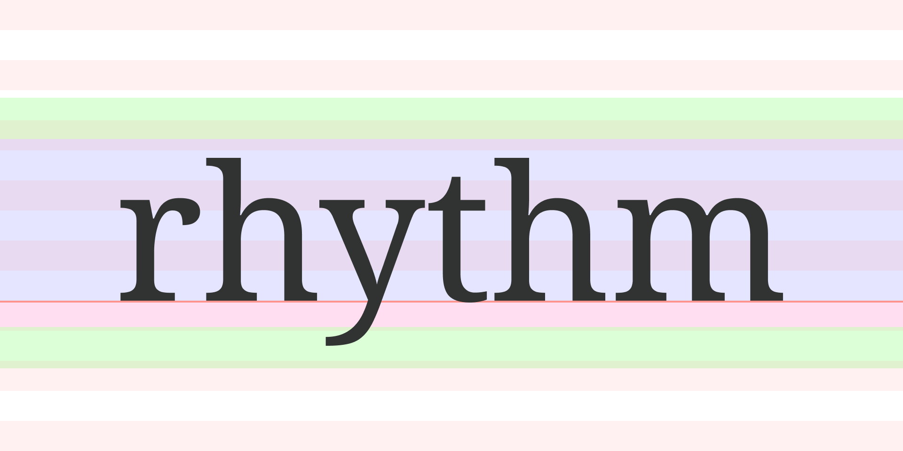
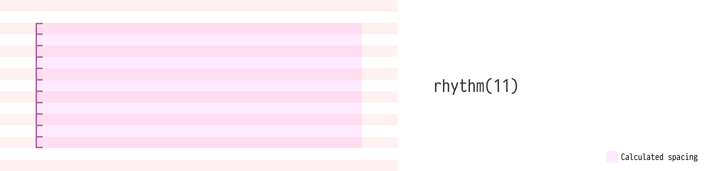
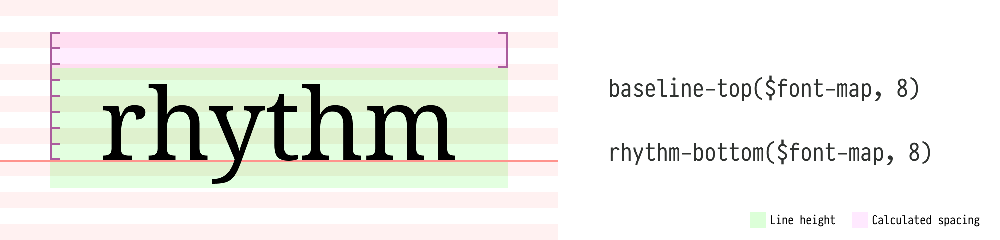
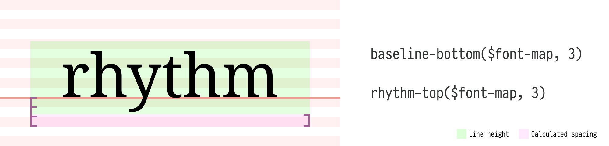
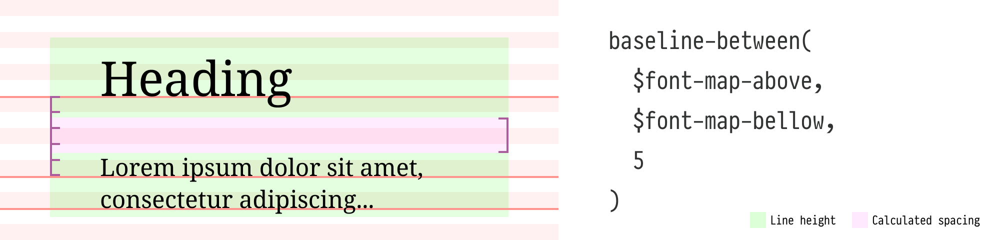

# rhythm-sass

[](https://www.npmjs.com/package/rhythm-sass)
[](https://github.com/p233/rhythm-sass/actions/workflows/test.yml)
[](https://opensource.org/licenses/MIT)



rhythm-sass is a Sass library for print-inspired vertical rhythm on the web: it computes the spacing that puts every text baseline on a vertical rhythm grid, with baseline offsets derived from the font's own metrics. It builds on concepts introduced by [Plumber](https://jamonserrano.github.io/plumber-sass/), and [rhythm-gpui](https://github.com/p233/rhythm-gpui) ports it to Rust for gpui apps.

No baseline ratio has to be measured by hand: rhythm-sass derives it from the `ascent`, `descent` and `units-per-em` values in the font's metrics tables, which the bundled `npx rhythm-sass` command reads for you. A measured `baseline-ratio` still works, such as one from [Plumber's table of baseline ratios for Google Fonts and Typekit faces](https://jamonserrano.github.io/plumber-sass/baselines/), and [the rhythm-sass post](https://peiwen.lu/posts/rhythm-sass) explains the model behind the ratio.

rhythm-sass works in Sass at build time and covers type and the spacing around it. It does not fit images or other media to the grid, and it does not correct for how each browser rounds a baseline; [Functions](#functions) explains where browsers differ.

## Installation

Install it from npm:

```
npm install --save-dev rhythm-sass
```

## Usage

```scss
// Option 1: Use directly in your stylesheet
@use "pkg:rhythm-sass" as * with (
  $ascent: 1069,               // Noto Serif hhea metrics
  $descent: -293,
  $units-per-em: 1000,         // optional, defaults to 1000
  $rhythm-size: 8px,           // optional
  $rem-size: 16px              // optional
);

// Option 2: A measured ratio instead of metrics
@use "pkg:rhythm-sass" as * with (
  $baseline-ratio: 0.112061    // mutually exclusive with $ascent/$descent
);

// Option 3: Forward with custom settings to be used in other files
@forward "pkg:rhythm-sass" with (
  $ascent: 1069,
  $descent: -293
);

// Set the primary font size and family
:root {
  font: 16px/1 "Noto Serif", serif;
}
```

> **Note:** `pkg:` URLs need Sass 1.71 or later with its `NodePackageImporter` registered, such as `importers: [new NodePackageImporter()]` in Vite's `css.preprocessorOptions.scss` or in sass-loader's `sassOptions`. Without it, use `"rhythm-sass"`, which Vite resolves through the package's `sass` export.

This library exposes the following global variables:

- `$ascent`, `$descent`, `$units-per-em` specify the primary font's vertical metrics in font units, as reported by its metrics tables. The baseline ratio is derived as `(units-per-em + |descent| - ascent) / (2 * units-per-em)`; descent is accepted in either sign convention. `$units-per-em` defaults to `1000`.

- `$baseline-ratio` specifies the baseline ratio for the primary font directly, such as `0.112061` for Noto Serif. Configure either this or the metrics above, not both. All of them may be omitted when every font-map carries its own ratio or metrics.

- `$rhythm-size` specifies the base unit height for the vertical rhythm grid. The default value is `8px`.

- `$rem-size` specifies the reference value for calculating `rem` units, in an absolute length unit. The default value is `16px`. Ignore this setting if you do not use the `rem` unit.

## Measuring fonts

The package ships a zero-dependency command that reads TTF/OTF/TTC files and prints everything rhythm-sass consumes:

```
npx rhythm-sass path/to/NotoSerif.ttf
```

```
NotoSerif.ttf — Noto Serif Regular
  units-per-em  1000
  hhea          ascent 1069   descent -293   baseline-ratio 0.112000
  OS/2 typo     ascent 1069   descent -293   baseline-ratio 0.112000
  OS/2 win      ascent 1069   descent -389   baseline-ratio 0.160000
  cap-height-ratio  0.714000
  x-height-ratio    0.536000
  USE_TYPO_METRICS  set

  Example font-map keys (OS/2 typo candidate; verify in the target engine):
    ascent: 1069,
    descent: -293,
    units-per-em: 1000,
    cap-height-ratio: 0.714000,
```

A font carries several candidate sets of vertical metrics. [CSS Inline Layout](https://www.w3.org/TR/css-inline-3/#ascent-descent) recommends `OS/2` typo metrics when available and `hhea` as a fallback, but browser engines and legacy platform APIs can differ; `USE_TYPO_METRICS` is a signal, not a universal selector. Compare the rows and verify the metric set used by your target runtime. `OS/2` win values are primarily clipping metrics.

Metric-derived ratios may legitimately fall outside `0..1` when a font extends beyond its em box (such as Noto Nastaliq Urdu or math extension faces); the command flags such rows inline. Keep the printed `ascent`/`descent` keys in that case, since `baseline-ratio` accepts only measured values between `0` and `1`. For variable fonts, the command reports the default instance and warns when axis-specific MVAR metrics may differ. WOFF/WOFF2 files must be decompressed to TTF/OTF first, with fontTools for example.

## The font-map

This library reads your typography settings from Sass maps called **font-maps**. For example:

```scss
$heading-font: (
  font-size: 32px,             // required
  line-height: 5,              // required
  font-family: "Georgia",      // optional
  ascent: 1878,                // optional, with descent
  descent: -449,               // optional, with ascent
  units-per-em: 2048,          // optional, defaults to 1000
  cap-height-ratio: 0.692871   // optional, enables cap-top/cap-bottom
);
```

- `font-size` corresponds to the CSS `font-size` property. Any absolute length unit or `rem` is accepted and converted to the `$rhythm-size` unit automatically.

- `line-height` corresponds to the CSS `line-height` property, counted in rhythm grids: it accepts only integers, and `line-height: 5` is five times the global `$rhythm-size`. Whole rhythms keep every following line of a block on the grid.

- `ascent`, `descent`, `units-per-em` provide the font's own metrics, overriding the global configuration for this font; a secondary typeface usually needs them.

- `baseline-ratio` overrides the global configuration with a measured ratio between `0` and `1` instead. A font-map may carry either metrics or `baseline-ratio`, not both.

- `cap-height-ratio` specifies the positive capital height relative to the em size (`sCapHeight / units-per-em`, printed by `npx rhythm-sass`). It can be `1` or greater when capitals extend beyond the em box. It is required by the `cap-top()`/`cap-bottom()` functions and refines the `drop-cap` mixin.

A font-map may also carry other CSS properties, such as `font-family` or `letter-spacing`. The [`font`](#fontfont-map-spacing-map) mixin emits them and never emits the metric keys. Leave out `padding` and `margin`: the spacing functions calculate them.

Create a font-map for each type of text, such as headings, subheadings, paragraphs or code, to keep your typography styles organized and reusable.

## Functions

Functions use the `font-size`, `line-height` and ratio values from the provided font-map for calculations, producing results in the global `$rhythm-size` unit.

Results are exact to Sass's number precision: offsets are never rounded to whole pixels. Rounding the above/below offsets independently would break the `above + below == line-height` identity that keeps every block on whole rhythm rows.

Browsers do not all paint a fractional baseline on the same pixel, though. Measured on macOS, Chromium rounds a font's ascent and descent to whole pixels before centering them in the line box, Firefox rounds them up, and WebKit keeps the exact value. Many sizes land on the same pixel in all three. Where one does not, as can happen with a large drop cap, [`drop-cap-metrics()`](#drop-cap-metricsfont-map-lines-cap-font-map-null) exposes the solved values so a stylesheet can adjust them.

### `rhythm($rhythms, $offset: 0)`



The `rhythm()` function calculates the total height of a specified number of rhythm grids. It accepts two arguments:

- `$rhythms`: The number of rhythm grids
- `$offset` (optional): Adjusts the calculated result for additional sizing factors, such as border width. Must carry a length unit.

For example, if you want to add a top padding of 5 rhythm grids to an element with a 1px top border, the actual `padding-top` should be `39px` instead of `40px` (assuming an 8px rhythm). You can calculate the correct padding using a `-1px` offset parameter:

```scss
padding-top: rhythm(5, -1px);
```

An offset in a different unit from `$rhythm-size`, such as `rem` against `px`, makes the function return a `calc()` expression.

### `baseline-top($font-map, $rhythms, $offset: 0)` <br/> `rhythm-bottom($font-map, $rhythms, $offset: 0)`



The `baseline-top()` function calculates the spacing from the top of the font's line-height to the top of the nth rhythm grid **above** the baseline. It accepts:

- `$font-map`: The current font map.
- `$rhythms`: The number of rhythm grids between the baseline and the target rhythm grid above it.
- `$offset` (optional): Adjusts the calculated spacing.

`rhythm-bottom()` is the same function under a name that reads from the grid line: the spacing from the top of the nth rhythm grid above the baseline to the top of the font's line-height.

### `baseline-bottom($font-map, $rhythms, $offset: 0)` <br/> `rhythm-top($font-map, $rhythms, $offset: 0)`



The `baseline-bottom()` function calculates the spacing from the bottom of the font's line-height to the bottom of the nth rhythm grid **below** the baseline. It accepts:

- `$font-map`: The current font map.
- `$rhythms`: The number of rhythm grids between the baseline and the target rhythm grid below it.
- `$offset` (optional): Adjusts the calculated spacing.

`rhythm-top()` is the same function under a name that reads from the grid line: the spacing from the bottom of the nth rhythm grid below the baseline to the bottom of the font's line-height.

### `baseline-between($font-map-above, $font-map-below, $rhythms, $offset: 0)`



The `baseline-between()` function calculates the spacing between two fonts, from the bottom of the above font's line-height to the top of the below font's line-height. It accepts:

- `$font-map-above`: The font map of the above element.
- `$font-map-below`: The font map of the below element.
- `$rhythms`: The number of rhythm grids between adjacent text baselines.
- `$offset` (optional): Adjusts the calculated spacing.

### `cap-top($font-map, $rhythms, $offset: 0)` <br/> `cap-bottom($font-map, $rhythms, $offset: 0)`

The `cap-top()` function lands the capital letters' **ink**, rather than the baseline, on the nth grid line. It works like CSS `text-box-trim: trim-start` with `text-box-edge: cap`, but measures from a grid line, for openings where the eye measures ink to edge, such as heroes, cards and page tops. It requires a `cap-height-ratio` key in the font-map.

A cap-anchored block shifts its baselines off the grid by the fractional part of the cap height, so it must be closed with `cap-bottom()` rather than `baseline-bottom()`. `cap-bottom()` returns at the bottom exactly what `cap-top()` trimmed at the top, and the pair makes the block span a whole number of rhythm grids, keeping everything after it in rhythm:

```scss
.hero-heading {
  @include font(
    $heading-font,
    (
      padding-top: cap-top 3,
      padding-bottom: cap-bottom 1
    )
  );
}
```

### `drop-cap-metrics($font-map, $lines, $cap-font-map: null)`

The `drop-cap-metrics()` function returns the solution the [`drop-cap`](#drop-capfont-map-lines-cap-font-map-null-clear-lines-0) mixin emits, as a map with `font-size`, `line-height` and `top` keys. Use it when a stylesheet needs the values themselves, for example to check where each browser paints the capital and adjust its size before applying it. `$lines` and `$cap-font-map` work as in the mixin; `$clear-lines` only adds a margin, so it has no counterpart here.

```scss
@use "sass:map";

$cap: drop-cap-metrics($paragraph-font, 3);

.paragraph-drop-cap {
  float: left;
  position: relative;
  top: map.get($cap, top);
  font-size: map.get($cap, font-size);
  line-height: map.get($cap, line-height);
}
```

## Mixins

### `font($font-map, $spacing-map)`

The `font` mixin emits a font-map as CSS: `font-size`, `line-height` in rhythm grids and every other key except the metric keys (`baseline-ratio`, `ascent`, `descent`, `units-per-em` and `cap-height-ratio`). Its optional `$spacing-map` resolves margins and paddings through the rhythm functions.

The `$spacing-map` accepts four keys, each corresponding to a CSS property:

- `margin-top`
- `margin-bottom`
- `padding-top`
- `padding-bottom`

These keys use a special syntax to call rhythm functions:

1. The value for each key is a Sass list.
2. The first item in the list is the function name: `rhythm` or `baseline-between` for any key, `baseline-top` or `cap-top` for the top keys and `baseline-bottom` or `cap-bottom` for the bottom keys.
3. The remaining items are the function arguments.
4. For all functions except `rhythm`, the current `$font-map` is automatically injected and should be omitted from the arguments. For `rhythm`, no font-map is needed and the arguments are passed directly.
5. When calling the `baseline-between` function:
   - For `padding-top` and `margin-top`, the current `$font-map` is treated as `$font-map-below`.
   - For `padding-bottom` and `margin-bottom`, the current `$font-map` is treated as `$font-map-above`.

Example usage:

```scss
$paragraph-font: (
  font-size: 20px,
  line-height: 4
);

$quote-font: (
  font-size: 18px,
  line-height: 3,
  font-style: italic
);

.quote {
  @include font($quote-font, (
    margin-top: baseline-between $paragraph-font 3,
    padding-top: rhythm 1,
    padding-bottom: baseline-bottom 3
  ));
}
```

In this example:

- `margin-top` value is translated to `baseline-between($paragraph-font, $quote-font, 3)`.
- `padding-top` value is translated to `rhythm(1)`.
- `padding-bottom` value is translated to `baseline-bottom($quote-font, 3)`.

The [examples](./examples) folder has a complete page.

### `drop-cap($font-map, $lines, $cap-font-map: null, $clear-lines: 0)`

The `drop-cap` mixin solves a drop cap sunk `$lines` lines deep into text set in `$font-map`: it emits the `font-size`, `line-height`, `float` and baseline anchor that make the capital span from the first line's cap top down to the `$lines`-th baseline. Apply it to a real first-character wrapper so every emitted property, including the relative baseline inset, works consistently:

```html
<p><span class="paragraph-drop-cap">L</span>orem ipsum…</p>
```

```scss
.paragraph-drop-cap {
  @include drop-cap($paragraph-font, 3);

  margin-right: rhythm(1);
}
```

- `$clear-lines` (optional) reserves that many extra wrapped body lines below the letter. Letters with descender tails (Q, J) extend ink below the anchored baseline into the following line's row; `$clear-lines: 1` gives the tail its own clear row. Floats exclude text per whole line box, which is why the unit is body lines rather than rhythms; the clearance is always whole rhythms, and the grid stays intact:

```scss
.paragraph-drop-cap {
  @include drop-cap($paragraph-font, 3, $clear-lines: 1); // room for Q's tail
}
```

- `$cap-font-map` (optional) sets a different face for the capital: a map carrying the cap face's `ascent`/`descent` (or `baseline-ratio`), `cap-height-ratio` and any extra CSS properties such as `font-family`. Its `font-size` and `line-height` are solved by the mixin and therefore ignored.
- When a map has no `cap-height-ratio`, the classic `0.7em` approximation is used. It can misplace only the visual top, and the baseline anchor stays exact.
- The anchor is emitted as a relative inset (`position: relative; top: …`), not a margin: for cap-heavy faces whose capital height exceeds `ascent - descent`, such as Merriweather, the anchor is a downward shift, and a margin would push the following content off the grid.

`::first-letter` does not guarantee support for `position`/`top`, so it cannot carry the mixin's exact anchor portably. Browsers with `initial-letter` support can achieve native drop caps without a wrapper; this mixin is the portable, grid-aware alternative.

### `draw-rhythms($color: rgb(255 120 120 / 25%))`

The `draw-rhythms()` mixin draws the vertical rhythm grid over the page from your global settings, so you can see where text sits against it while you tune the typography.

```scss
// Include this mixin at the top level of your SCSS file; $production is your own flag.

@if not $production {
  @include draw-rhythms;
  // or with a custom color
  @include draw-rhythms(rgb(0 255 255 / 25%));
}
```

The mixin sets `position: relative` on `:root`. Before enabling it, check that your layout does not depend on another `position` value there.

## Keeping blocks on whole rows

Give every text block, such as a heading, paragraph or list, a height of whole rhythm grids, with its top and bottom edges on grid lines. Blocks then stack in any order without moving the rhythm of the page. Line heights are whole grids already; close a baseline-anchored block with `baseline-bottom()`, or a cap-anchored block with the paired `cap-bottom()`.

## Responsive typography

`$rhythm-size` is set once per compilation through `@use ... with`, so the Sass value cannot change at a breakpoint. A breakpoint can still change the type and the grid it sits on in the three ways below.

### One font-map per breakpoint

Set `$rhythm-size` to the smallest row the design needs and change the counts instead: each breakpoint gets its own font-map and its own `font()` call, and a wider screen keeps blocks on rows twice as tall by using even counts for line heights, baseline offsets and block heights.

```scss
@use "pkg:rhythm-sass" as * with (
  $ascent: 1069,
  $descent: -293,
  $rhythm-size: 4px
);

$paragraph-font: (
  font-size: 20.25px,
  line-height: 8 // 32px
);

$paragraph-font-mobile: (
  font-size: 18px,
  line-height: 7 // 28px
);

p {
  // 40px tall: five 8px rows, with the baseline 24px down.
  @include font($paragraph-font, (
    padding-top: baseline-top 6,
    padding-bottom: baseline-bottom 4
  ));

  @media (width <= 599px) {
    // 32px tall: eight 4px rows.
    @include font($paragraph-font-mobile, (
      padding-top: baseline-top 6,
      padding-bottom: baseline-bottom 2
    ));
  }
}
```

Each breakpoint is a separate solution for one font size, which keeps the number of sizes small enough to check in every target browser, as [Functions](#functions) describes.

### Scaling the grid with the root font size

With `$rhythm-size` and every font size in `rem`, the functions return `rem` as well, and the whole grid scales with the root font size. One font-map then serves every breakpoint, and a breakpoint changes only `font-size` on `:root`:

```scss
@use "pkg:rhythm-sass" as * with (
  $ascent: 1069,
  $descent: -293,
  $rhythm-size: 0.25rem
);

$paragraph-font: (
  font-size: 1.25rem,
  line-height: 8
);

:root {
  font-size: 16px; // 4px rows

  @media (width <= 599px) {
    font-size: 12px; // 3px rows
  }
}

p {
  @include font($paragraph-font, (
    padding-top: baseline-top 6,
    padding-bottom: baseline-bottom 4
  ));
}
```

Choose root sizes that keep a row a whole number of pixels, such as multiples of 4px for a `0.25rem` row; a fractional row puts fractional offsets on every block. Every element scales by the same factor, so a breakpoint cannot shrink headings more than body text, and each root size is another set of sizes to check in the browsers.

### Fluid sizes

The functions need a font size known at build time, so they cannot follow a size that changes with the viewport. The model is linear in the font size, though, and CSS can compute it: the baseline sits `0.5lh + (0.5 - r) * 1em` below the top of the line box, where `r` is the baseline ratio, and `round()` snaps the line height to the row. For Noto Serif, `0.5 - r` is `0.388`:

```css
.display-heading {
  --row: 8px;

  font-size: clamp(51.96px, 38.25px + 3.52vw, 83.25px);
  line-height: round(up, 1em + 28px, var(--row));
  padding-top: calc(128px - 0.5lh - 0.388em); /* baseline 128px below the top */
  padding-bottom: calc(56px - 0.5lh + 0.388em); /* 184px in all */
}

@media (width <= 599px) {
  .display-heading {
    --row: 4px;
  }
}
```

Measured on macOS with Chromium 153, Firefox 155 and WebKit 26.6 at 113 widths from 320px to 1440px, the baseline of such a block stays within 0.94px of its row. The fractional padding costs more: Chromium and WebKit leave the block 1/64px short at every width, and 64 such blocks push the text below them a pixel off the grid. Rounding `padding-top` to whole pixels and deriving `padding-bottom` from the fixed height keeps the block exact in Chromium and Firefox and at all but 6 widths in WebKit, but then Chromium puts the baseline a full pixel off at 23 of the 113 widths. The ratio of line height to font size also drifts, from 1.35 to 1.61 in this range.

Applying each engine's own rounding removes nearly all of the baseline error. Chromium rounds the ascent and descent to whole pixels and floors half the leading, Firefox rounds them up and splits the leading to the half pixel, and WebKit keeps the exact offset, which the CSS rounds to WebKit's 1/64px layout unit so the paddings lose nothing. `@supports` selects the model, since only Firefox parses `-moz-appearance` and only Apple's WebKit parses `-apple-system-body`:

```css
.display-heading {
  --above: calc(round(1.069em, 1px) + round(down, (1lh - round(1.069em, 1px) - round(0.293em, 1px)) / 2, 1px));
  padding-top: calc(128px - var(--above));
  padding-bottom: calc(56px - 1lh + var(--above));
}

@supports (-moz-appearance: none) {
  .display-heading {
    --above: calc(round(up, 1.069em, 1px) + (1lh - round(up, 1.069em, 1px) - round(up, 0.293em, 1px)) / 2);
  }
}

@supports (font: -apple-system-body) {
  .display-heading {
    --above: round(0.5lh + 0.388em, 0.015625px);
  }
}
```

`1.069` and `0.293` are Noto Serif's ascent and descent over its units per em. Measured the same way on a block of this kind, the baseline sits on its row in Chromium and Firefox and within 0.01px of it in WebKit, and the block keeps its height to within 1/64px. Any other engine falls back to Chromium's model, and a change to an engine's rounding needs its branch updated. With the ratio of line height to font size still drifting, a fluid size suits headings better than running text.

## Changelog

See [CHANGELOG.md](./CHANGELOG.md) for version history.

## Credits

This project is inspired by [Plumber](https://jamonserrano.github.io/plumber-sass/).

## License

[MIT](./LICENSE)
